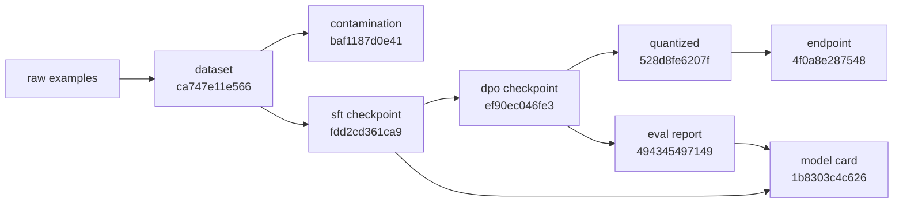

# llm-finetuning-framework

A reproducible pipeline DAG for fine-tuning runs, where every artifact records the exact upstream artifact it consumed. Change the seed and the dataset hash changes; re-run and every downstream hash changes with it. An eval report cannot silently point at a different checkpoint than the one it scored.

**This is not a training framework.** No GPU is involved, no model is trained, and every stage metric is a deterministic constant. What is real is the plumbing around a run: the artifact graph, the lineage rules, config validation, and a reproducible JSON report. If you want to see the training code, this repository will disappoint you on purpose rather than by accident.

| | |
|---|---|
| **Execution** | Real code, Python standard library only |
| **Tests** | 23 unit tests — `make test` |
| **CI** | Python 3.10 / 3.11 / 3.12, byte-for-byte reproducibility check, demo handler import check |
| **Training** | None. Stage metrics are synthetic by design |
| **Demo** | `demo/` — a static page plus a stdlib serverless handler, labelled as a simulation in the UI |
| **Authorship** | Solo |

---

## What is actually enforced

Each property names the test that fails if it regresses.

| Property | Proof |
|---|---|
| Stages run in the documented order and produce eight artifacts | `PipelineShapeTests.test_runs_every_stage_in_the_documented_order` |
| Every artifact names its producer | `test_every_artifact_names_its_producer_and_has_a_short_hash` |
| The contamination check records the dataset hash it scanned | `test_contamination_check_names_the_dataset_it_scanned` |
| SFT records the dataset hash it trained on | `test_sft_names_the_dataset_hash` |
| DPO records the checkpoint it started from | `test_dpo_names_the_checkpoint_it_started_from` |
| Quantization records the checkpoint it compressed | `test_quantization_names_the_checkpoint_it_compressed` |
| **The endpoint records the weights it serves** | `test_endpoint_names_the_weights_it_serves` |
| The eval report records the checkpoint it scored | `test_eval_names_the_checkpoint_it_scored` |
| The model card carries both the training and eval hashes | `test_model_card_carries_both_the_training_and_eval_hashes` |
| Two runs produce identical hashes | `test_two_runs_produce_identical_hashes` |
| A different seed changes the dataset hash | `test_a_different_seed_changes_the_dataset_hash` |
| The hash ignores wall-clock time | `test_content_hash_ignores_production_time` |
| Row counts only ever decrease through cleaning | `test_rows_only_disappear` |
| Invalid config fails once, with every problem listed | `test_reports_every_problem_at_once` |

The endpoint and model-card rows exist because the first version of this repository got them wrong: the served endpoint did not record which quantized artifact it was serving, and the model card claimed `eval_attached: true` without carrying the eval hash. Both are fixed, and both have a test.

---

## Run it

```bash
git clone https://github.com/dev4aibots/llm-finetuning-framework.git
cd llm-finetuning-framework

python main.py          # human-readable run
python main.py --json   # machine-readable report
make test               # 23 unit tests, no dependencies
```

No `pip install`, no virtualenv, no `.env`. If a dependency ever creeps in, CI installs nothing and fails.

Real output:

```
=== fine-tuning pipeline run ===
[data          ] running...
[data          ] -> artifact 'dataset' hash=ca747e11e566
[contamination ] running...
[contamination ] -> artifact 'contamination_check' hash=baf1187d0e41
[sft           ] running...
[sft           ] -> artifact 'sft_checkpoint' hash=fdd2cd361ca9
[dpo           ] running...
[dpo           ] -> artifact 'dpo_checkpoint' hash=ef90ec046fe3
[quantize      ] running...
[quantize      ] -> artifact 'quants' hash=528d8fe6207f
[serve         ] running...
[serve         ] -> artifact 'endpoint' hash=4f0a8e287548
[eval          ] running...
[eval          ] -> artifact 'eval_report' hash=494345497149
[model_card    ] running...
[model_card    ] -> artifact 'model_card' hash=1b8303c4c626

=== manifest ===
  dataset            dataset    ca747e11e566 by Datatrove+Nemotron-CC+Presidio
  contamination_check report     baf1187d0e41 by minhash-lsh
  sft_checkpoint     checkpoint fdd2cd361ca9 by axolotl v0.8 + ZeRO-3
  dpo_checkpoint     checkpoint ef90ec046fe3 by trl 0.15 DPO
  quants             quant      528d8fe6207f by gptq+awq+llama.cpp
  endpoint           endpoint   4f0a8e287548 by vllm+speculators
  eval_report        report     494345497149 by lm-eval-harness
  model_card         report     1b8303c4c626 by mof-template

=== eval report ===
{
  "from": "ef90ec046fe3",
  "mmlu_pro_delta": 3.2,
  "mt_bench_v2_delta": 0.41,
  "rewardbench2_delta": 0.08,
  "llama_guard_4_pass": 0.987
}

=== served endpoint ===
{
  "from": "528d8fe6207f",
  "backend": "vLLM 0.7 + EAGLE-3",
  "quant": "GPTQ-INT4-Marlin",
  "eagle_acceptance": 0.74,
  "p99_bs8_ms": 126,
  "tokens_per_sec_bs32": 6400,
  "dollars_per_mtokens": 0.28
}
```

The numbers are synthetic and stay identical between runs on purpose: that is what makes the reproducibility check meaningful. They are shaped like the metrics a real run would produce, not measured from one.

---

## Lineage



The rule is simple and enforced by tests: **an artifact that consumes another artifact stores that artifact's content hash in its own payload.** Because the hash covers the payload, the dependency is transitive — change the dataset and the model card changes too.

---

## Design decisions

**Content hash as artifact identity, not a filename.** `checkpoints/final` is a name two runs can share. A hash over the payload is either the same artifact or a different one, and every downstream stage that stores it inherits that guarantee.

**`produced_at` is deliberately outside the hash.** Wall-clock time makes otherwise identical runs compare as different. It stays on the artifact for human debugging and is excluded from the identity, which is asserted by `test_content_hash_ignores_production_time`.

**Validate before the first stage.** `run_pipeline` collects every config problem and raises once. A `KeyError` from inside stage four, after three stages have printed output, is a worse experience than one message naming all three problems.

**A deterministic simulation, labelled as one.** Every stage is a pure function of the config, so the DAG, the lineage and the report can be tested in milliseconds without a GPU. The demo UI states "stage metrics are synthetic" in a banner. The alternative — inventing a plausible A100 run — is what this README used to do, and it is indefensible in an interview.

---

## What this is not

- **Not a training framework.** No PyTorch, no HuggingFace, no GPU. Those names appear as `produced_by` labels because they are the tools a real implementation would call.
- **Not a benchmark.** There is no measured accuracy, loss curve or VRAM number in this repository, because none was measured.
- **Not a persisted manifest.** The manifest lives in memory for the duration of a run. Persisting it (SQLite, object storage, MLflow) is the obvious next step and is listed in `docs/limitations.md`.
- **Hashes are 12 hex characters.** That is 48 bits, fine for telling artifacts apart within a manifest and useless as a security boundary. Full 64-character digests are a one-line change if the manifest ever leaves the process.

---

## Layout

```
main.py                     pipeline stages, manifest, CLI (--json)
tests/test_pipeline.py      23 unit tests over the DAG and the lineage rules
docs/                       architecture, decisions, evaluation, limitations
demo/                       static demo + stdlib serverless handler
demo/pipeline/pipeline.py   vendored copy of the stages used by the demo
```

## License

MIT — see [LICENSE](LICENSE).

## Contact

Devraj Gadhvi · [dev4aibots.com](https://dev4aibots.com) · [hello@dev4aibots.com](mailto:hello@dev4aibots.com) · [linkedin.com/in/devraj0770](https://linkedin.com/in/devraj0770)
